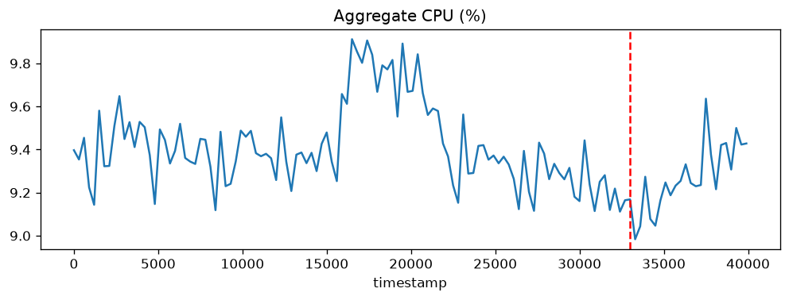
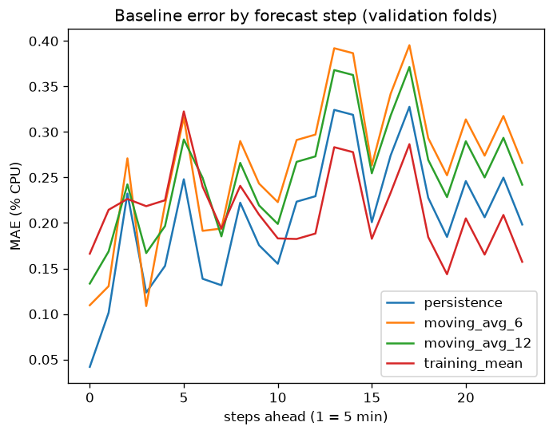

# Cloud Workload Forecasting & Analysis — Final Report

**Author:** Abhishek Kumar · **Dataset:** Azure Public Dataset V2, `data-v1` release · **Code:** `src/cwfc/`, `notebooks/01–06`

All CPU values are percentages of VM CPU; differences between forecasts are in **percentage points (pp)**. Time is the source's integer seconds from the start of the Azure trace.

---

## 1. Executive summary

**How predictable is the workload?** At fleet level it is very stable and only weakly predictable. Aggregate CPU stays within about 9.0–9.9% (training mean 9.41%, std 0.19 pp). Beyond roughly one hour the best forecast is simply the typical level.

**How accurate can near-term demand be forecast?** For the 2-hour horizon, the final model's validation MAE is about 0.19–0.21 pp, roughly a 2% error relative to the level. `active_vm_count` is exactly 10,000 at every timestamp, so it is forecast without error. This is a property of how the dataset was built, not of Azure (Section 2).

**What was chosen?** A mean-reverting AR(1) model: start from the latest value and decay toward the training mean (φ = 0.67, half-life 1.7 steps). It was compared with six simple baselines and a ridge-regression model. The ridge model was worse than every baseline and was rejected.

**An honest caveat.** Persistence, the training mean and AR(1) are not clearly separable on 110 points. AR(1) did **not** fully meet the acceptance rule set in advance (Section 6); it was chosen for the best average rank and the most stable worst case, and the deviation is disclosed.

**What should the infrastructure team do?** Plan for forecast + **0.46 pp** (about 5% above the forecast). On validation this margin was exceeded in 4.2% of intervals, all inside one episode, the onset of a load bump, which no model here could anticipate. Refresh the forecast every five minutes, alert when fleet CPU enters the high regime, and monitor hot VMs and the Delay-insensitive segment separately.

---

## 2. Data understanding and preprocessing

### 2.1 What the data is

10,000 VMs × 134 readings at 5-minute spacing (1,340,000 rows, about 11.1 hours), plus one metadata row per VM. File checksums matched `SHA256SUMS`. Per `DATA_CARD.md`, the VMs come from the first three shards of the Azure trace; only VMs with complete traces over the window were eligible, and 10,000 were then drawn deterministically, stratified by VM category and core bucket.

### 2.2 Quality checks

| Check | Result |
|---|---|
| Distinct timestamps / spacing | 134 / all gaps exactly 300 s (0 → 39,900 s) |
| Rows per VM / per timestamp | 134 for every VM / 10,000 for every timestamp |
| Missing values | 0 in every column |
| Duplicate (vm_id, timestamp) | 0 |
| Values outside [0, 100], or violating min ≤ avg ≤ max | 0 |
| VMs in readings but not metadata, and the reverse | 0 and 0 |

These agree with the publisher's own validation list. Nothing needed repair, but the rules below are implemented in code so the pipeline also works on other data.

### 2.3 Consequences of the selection rule

- **No VM churn is observable.** Every VM is present at every step, so `active_vm_count` is constant at 10,000 *by construction*. The metadata lifetimes agree (median 719.8 h, minimum 11.25 h, a survivorship effect). The report therefore does not claim anything about churn in real clouds.
- **Segment proportions describe this sample.** Category and core-bucket shares come from stratified sampling and should not be generalised to Azure.

### 2.4 Target construction (Section B)

Both targets are built from the readings file only, at the native 5-minute cadence. A coarser cadence was rejected: the grid is already regular, only 110 training points exist, and the holdout is exactly 24 five-minute steps.

| Rule | Choice |
|---|---|
| Valid observation | `avg_cpu` finite and within [0, 100] |
| Duplicates | first row kept, so a VM is counted at most once per timestamp |
| `active_vm_count` | distinct VMs with a valid reading |
| `aggregate_cpu_utilization` | mean of valid `avg_cpu`; missing readings skipped, never filled |
| Missing timestamp | left as NaN, never invented (none occur here) |

The full 134-point series was built **first**, then split chronologically: rows 1–110 are training (0–32,700 s) and rows 111–134 the holdout (33,000–39,900 s).

### 2.5 Features deliberately excluded

The metadata columns `avg_cpu`, `max_cpu`, `p95_max_cpu` and `timestamp_vm_deleted` are source-level statistics that may summarise the whole VM lifetime, including the holdout and later. They would not be available at forecast time and were not used.

---

## 3. Workload analysis

*Pattern statistics use the training window only; data-quality checks used all 134 steps.*



**CPU is heavily skewed.** Across all readings the mean is 9.4% and the median 5.1%, but p95 is 37% and p99 87%. 46% of VMs average under 5% CPU, while 2.2% average above 50%. In the training window, the busiest 5% of VMs (500 VMs) account for 30% of all CPU use.
*Why it matters:* there is a lot of idle capacity, and a small hot minority carries much of the load. Fleet averages say little about those VMs.

**Five-minute averages hide spikes.** The gap between `max_cpu` and `avg_cpu` has a median of 3.3 pp, a 75th percentile of 10.7 pp, and a maximum of 95.5 pp.
*Why it matters:* a forecast of average CPU understates short-lived peak risk, so a margin is needed.

**Temporal behaviour.** The aggregate has no trend (mean step change about 0, std 0.16 pp) and one visible episode, a bump at steps 55–68 (16,500–20,400 s) peaking near 9.9%. Autocorrelation of the training series:

| Lag (steps) | 1 | 2 | 3 | 6 | 12 | 24 |
|---|---|---|---|---|---|---|
| Autocorrelation | 0.67 | 0.61 | 0.68 | 0.48 | 0.37 | −0.03 |

Memory is about an hour and gone by two hours. With 11 hours of data, daily or weekly seasonality **cannot be tested**, and the timestamps give no real clock time.

**Segments behave differently** (training window):

| VM category | VMs | Share | Mean CPU | p95 CPU |
|---|---:|---:|---:|---:|
| Delay-insensitive | 6,180 | 61.8% | 8.26 | 25.9 |
| Interactive | 3,091 | 30.9% | 11.51 | 49.1 |
| Unknown | 729 | 7.3% | 10.35 | 52.5 |

The per-category time series shows that the **Delay-insensitive** group produces the bump, **Unknown** drifts down (about 11.2 → 9.3), and **Interactive** is flat. The 2-core and 4 GB groups have high p95 values (39 and 59 respectively). The >24-core and >64 GB buckets contain the same 10 VMs and are not independent evidence.

**Peaks.** A peak is defined as aggregate CPU at or above the training 90th percentile (**9.668%**), a threshold fixed from training data only. All peak steps fall in one episode (55–68).
*Why it matters:* peak-period accuracy rests on a single event.

---

## 4. Forecasting approach

**Final model: mean-reverting AR(1).** With μ the training mean and φ the lag-1 coefficient estimated on the demeaned training series (clipped to [0, 0.99]):

> ŷ(t + h) = μ + φʰ · (y(t) − μ)

On the full training window φ = 0.672 (half-life 1.7 steps). It reduces to persistence for the first few steps and to the training mean afterwards. It needs no hand-set parameters and adjusts itself if the data have no persistence. Both targets use the same model; for the constant `active_vm_count` it returns the constant, with no hard-coded value.

**Baselines:** persistence, moving averages (3/6/12), training mean, seasonal-naive (12/24).

**Learned alternative (rejected):** ridge regression with one model per horizon step, using only origin-time features (latest value, 3-step and 12-step means, each relative to an expanding mean). Three regularisation strengths were tried.

**Search effort:** four model configurations in total (AR(1) and three ridge settings). Moving-average windows and seasonal lengths were also compared, using training-fold data only.

**Information availability.** Every input is a training value up to the forecast origin. Statistics (μ, φ, expanding means) are fitted on the training slice only, windows are trailing, and the peak threshold comes from training data.

---

## 5. Validation methodology

Time-aware **expanding-window rolling-origin validation inside the 110 training rows only**. Nothing is shuffled, and training always ends before validation begins.

| Item | Primary | Sensitivity check |
|---|---|---|
| Horizon | 24 steps (2 h) | 24 steps |
| Minimum training size | 50 | 30 |
| Origin step | 12 (1 h) | 6 |
| Folds | 4 (validation rows 50–73, 62–85, 74–97, 86–109) | 10 |

*Why this matches production:* each fold issues a two-hour forecast from the history available at that moment, exactly as the real task does. The horizon equals the real horizon.
*Limits:* the windows overlap (step < horizon), so folds are not independent; there are only four primary folds, one load episode, and 11 hours of history. The 10-fold run was added after seeing that the baseline ranking was fragile; it is a sensitivity check, not a way to find a better score. A test (`tests/test_validation_guard.py`) confirms validation never touches the holdout.

---

## 6. Results versus baseline

### 6.1 Aggregate CPU (pooled validation errors, pp)

| Model | Primary MAE | Primary RMSE | 10-fold MAE | 10-fold RMSE |
|---|---:|---:|---:|---:|
| **AR(1) mean-reverting** | 0.2060 | **0.2425** | **0.1904** | **0.2380** |
| Persistence | **0.2056** | 0.2540 | 0.2384 | 0.2881 |
| Training mean | 0.2141 | 0.2497 | 0.1949 | 0.2415 |
| Moving average (3 / 6 / 12) | 0.2353 / 0.2659 / 0.2545 | 0.2777 / 0.3077 / 0.2972 | 0.2226 / 0.2255 / 0.2368 | 0.2765 / 0.2857 / 0.2915 |
| Seasonal-naive (12 / 24) | 0.2634 / 0.3124 | 0.3142 / 0.3517 | 0.2455 / 0.2734 | 0.3031 / 0.3277 |
| Ridge, α = 0.01 / 0.1 / 1 | 0.3006 / 0.2476 / 0.2628 | 0.3518 / 0.2942 / 0.2985 | 0.2416 / 0.2135 / 0.2289 | 0.3166 / 0.2705 / 0.2778 |

Relative improvement of AR(1) (positive = better):

| vs | Primary MAE | Primary RMSE | 10-fold MAE | 10-fold RMSE |
|---|---:|---:|---:|---:|
| Persistence | −0.2% | +4.5% | +20.1% | +17.4% |
| Training mean | +3.8% | +2.9% | +2.3% | +1.4% |

Persistence is best on primary MAE but only 5th of 7 in the 10-fold run, and the training mean flips the other way, so **the baseline ranking is not stable**. Moving averages and seasonal-naive lose because the series has level shifts that lag a trailing average and no seasonality to repeat. All ridge settings lose to every baseline; with about 110 points the learned correction adds variance (the weakest regularisation is worst), a negative result.



Persistence is the most accurate for roughly the first hour and the training mean afterwards, matching the autocorrelation decay. Each point averages only four overlapping folds, so individual wiggles are noise.

### 6.2 The acceptance rule, and where AR(1) fell short

Before running candidates, the rule was: a candidate becomes the final model only if it beats both persistence and the training mean on MAE **and** RMSE under both fold designs, and wins at least 3 of 4 primary folds against each. **AR(1) did not meet it completely:**

- primary MAE vs persistence: worse by 0.0004 (0.2%), effectively a tie;
- it beat persistence in only 1 of 4 primary folds (7 of 10 in the sensitivity run), and the training mean in 4 of 4 and 4 of 10, with many ties (in fold 1, AR(1) had φ ≈ 0.03 and equals the training mean).

AR(1) was nevertheless selected because: (i) it has the best average rank across the four pooled comparisons (persistence ranks 1st, 3rd, 3rd, 3rd; training mean 3rd, 2nd, 2nd, 2nd); (ii) its worst fold is better than persistence's (10-fold fold MAE ranges 0.08–0.30 for AR(1) vs 0.12–0.46 for persistence); (iii) it adapts to the data without tuning. **Persistence, the training mean and AR(1) should be regarded as statistically indistinguishable here.** The choice is a judgement, not a proven win.

### 6.3 `active_vm_count`

Every model, including all baselines, has MAE = RMSE = 0 on validation and holdout, a tie. The forecast of 10,000 follows from the training window and the dataset construction, not from a hard-coded constant.

### 6.4 One-time holdout check (reporting only)

After the model, its parameters and the margin were fixed, the holdout was scored **once** and nothing was changed afterwards. It played no part in fitting, feature selection, tuning or model selection.

| Model | Holdout MAE | Holdout RMSE |
|---|---:|---:|
| AR(1) (final) | 0.1533 | **0.1832** |
| Persistence | **0.1468** | 0.1848 |
| Training mean | 0.1746 | 0.2105 |

The final model is about 12–13% better than the training mean and about level with persistence (MAE 4% worse, RMSE 1% better). On 24 correlated points this is consistent with validation but proves little. A plausible reason persistence does well is that the training series ended at a low value (9.16%) and the holdout stayed low (mean 9.27%, below the training mean of 9.41%), which suits a forecast that starts from the last value. This is an after-the-fact interpretation.

---

## 7. Error and failure analysis

### 7.1 Peaks and bias

Error = actual − forecast, so positive means the forecast was too low (the costly direction).

| Model | Overall MAE | Peak MAE | Non-peak MAE | Peak bias | Overall bias |
|---|---:|---:|---:|---:|---:|
| AR(1) | 0.2060 | 0.3897 | **0.1693** | +0.3897 | −0.0078 |
| Persistence | 0.2056 | **0.2953** | 0.1877 | +0.2782 | −0.0665 |
| Training mean | 0.2141 | 0.4159 | 0.1738 | +0.4159 | −0.0048 |

AR(1) is almost unbiased overall but under-forecasts at **every** peak row, by about 0.4 pp (roughly 4% of the level). This is partly mechanical: forecasts near the mean will look low whenever the actual value is high. The operational concern is real nonetheless. The model looks fine on average and is weakest when the fleet is busiest. Peak rows come from one episode and are counted several times by overlapping windows.

### 7.2 Where and why it fails

- **Level-shift onsets.** In fold 1 (rows 50–73), which begins just before the bump, the mean error is +0.29 pp, with 92% of errors positive and a maximum of 0.53 pp. At the forecast origin the model had no sign of the coming rise (φ ≈ 0.03 on 50 training points). Only reaction after the shift starts is possible.
- **Declines.** In folds 3 and 4 (after the bump), the mean errors are −0.16 and −0.20 pp (forecast too high). Persistence lags the fall; the cost is over-provisioning.
- **Model misspecification.** AR(1) implies a lag-12 autocorrelation of about 0.01, but the data show 0.37. The series seems to mix fast noise with slow level shifts that one decay rate cannot fit.
- **Cold start.** φ is 0.03 with 50 training points, 0.61 with 62 and 0.67 with 110, so forecast quality depends on seeing a level shift in the history.

### 7.3 Forecast error quantiles (AR(1), primary folds, about 96 overlapping rows)

| Quantile | 50% | 80% | 90% | 95% | 99% |
|---|---:|---:|---:|---:|---:|
| Error (pp) | −0.074 | 0.214 | 0.396 | 0.456 | 0.522 |

Errors are lopsided (median negative, long positive tail). Error does not clearly grow with horizon (95th percentile 0.383, 0.467, 0.416 for steps 0–5, 6–11, 12–23; differences are noise), so one margin serves the whole horizon. With about 96 overlapping rows, the 95th and especially the 99th percentile are rough.

---

## 8. Capacity-planning recommendation

### 8.1 Margin trade-off (validation, AR(1))

| Margin (pp) | % of level | Under-provisioned intervals | Average unused headroom (pp) |
|---:|---:|---:|---:|
| 0.00 | 0.0 | 36.5% | 0.107 |
| 0.10 | 1.1 | 32.3% | 0.172 |
| 0.20 | 2.1 | 22.9% | 0.244 |
| 0.30 | 3.2 | 12.5% | 0.326 |
| 0.40 | 4.2 | 10.4% | 0.414 |
| **0.46** | **4.9** | **4.2%** | **0.470** |
| 0.50 | 5.3 | 3.1% | 0.508 |
| 0.60 | 6.4 | 0.0% | 0.608 |

"Under-provisioned" means actual demand exceeded forecast + margin. The 0.46 pp breaches all occur in fold 1 (4 of its 24 rows, 16.7%), the onset of the bump. In the other three folds there are none.

### 8.2 Policy

1. **Base rule.** Provision for **forecast + 0.46 pp** of fleet CPU (about 1.05 × the forecast). This is a one-sided margin from the 95th percentile of validation errors, i.e. a simple empirical uncertainty band, chosen from a stated target of at most about 5% under-provisioned intervals. A stricter target would need about 0.5–0.6 pp, but the data cannot support 99th-percentile precision.
2. **Refresh every five minutes.** The forecast is close to the typical level after roughly 35 minutes, so hours-ahead forecasts should not drive scaling.
3. **High-regime trigger.** If the latest fleet CPU is at or above the training peak threshold (9.67%), use the 99th-percentile margin (0.52 pp) and alert the on-call team. The model cannot anticipate a rise, so this reacts to one in progress. **This rule rests on a single episode and should be validated on more data before being trusted.**
4. **Segment and tail watch.** Monitor the Delay-insensitive category separately (it drives the bump), and alert on VMs with sustained high CPU (p99 about 87%; the busiest 5% of VMs carry about 30% of CPU). A fleet-level forecast cannot see these.

### 8.3 Under- versus over-provisioning

Under-provisioning means throttled VMs and slow responses, worst for the Interactive workloads (31% of VMs); Delay-insensitive work can wait. Over-provisioning means paying for idle hardware, and this fleet already has slack (46% of VMs average under 5% CPU). The recommended margin is only about 5% of the fleet level, small compared with the cost of an outage, so it leans conservative at fleet level. The expensive risk sits in the hot tail of individual VMs, hence rule 4.

*Report-only check:* on the final holdout, forecast + 0.46 pp was never exceeded (0 of 24 intervals), and the largest holdout value (9.64%) was below even the lowest forecast ceiling in the window (9.71%). The holdout is a lower-load period, so this says nothing about peak coverage.

---

## 9. Limitations and future work

**Limitations**
- Only 11.1 hours per VM: no daily or weekly seasonality, no real clock time, and a single load episode. Peak conclusions rest on that one event.
- Four overlapping primary folds (and ten in the check) give rough error estimates; the three leading methods cannot be separated statistically.
- Constant VM count by construction: churn and VM-count forecasting could not be studied. Segment shares come from stratified sampling.
- Margins are in percentage points of fleet CPU. Converting to cores, hosts or cost needs capacity data this release lacks.
- The acceptance rule was not fully met (Section 6.2), and the high-regime trigger is a hypothesis.
- Model search was small (four configurations) because of the data size.

**Future work**
- Validate on longer traces (the full 30-day Azure data) to test seasonality, multiple peaks and churn.
- Segment-level forecasts (Delay-insensitive, Interactive) and a model with a slow level component plus fast noise (for example local-level or ETS) to address the AR(1) misspecification.
- Prediction intervals fitted to more folds, evaluated with proper coverage tests, and used in an automated scaling policy.
- Per-VM tail-risk models for the hot minority.
- Anomaly detection around level-shift onsets, and comparison with another cloud trace (e.g. Google ClusterData2019).

---

## Appendix: reproduction and final predictions

```
python -m venv .venv && .venv\Scripts\Activate.ps1
python -m pip install -e ".[dev]"
mkdir challenge_data && tar -xzf data-v1.tar.gz -C challenge_data
python -m pytest -q
python -m cwfc.predict --data challenge_data --output predictions.csv
```

`predictions.csv` has 24 rows with columns `timestamp,active_vm_count,aggregate_cpu_utilization`, timestamps 33,000–39,900 s. `active_vm_count` is 10,000 in every row. Aggregate CPU starts at 9.246% (last training value 9.165%) and converges to the training mean of 9.414% by about step 13, because φ = 0.672. The forecaster receives only the holdout *timestamps*, never its target values; `tests/test_predict.py` confirms that changing the holdout data does not change the predictions.